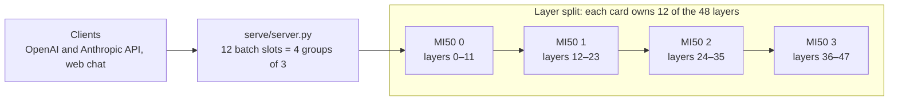
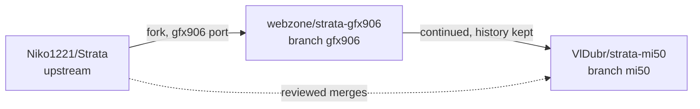

<p align="center">
  <picture>
    <source media="(prefers-color-scheme: dark)" srcset="apps/host/public/brand/strata-lockup-dark.svg">
    
  </picture>
</p>

<h3 align="center">strata-mi50 · Strata for AMD Instinct MI50 / MI60 (gfx906)</h3>

<p align="center">
  Qwen3.8-Flash-Next on four MI50 32 GB cards:<br>
  <b>83 tok/s</b> for one user, <b>170 tok/s</b> in total for ten users at once, up to <b>262,144 tokens</b> of context.
</p>

<p align="center">
  <a href="#highlights">Highlights</a> · <a href="#performance">Performance</a> ·
  <a href="#quick-start"><b>Quick start</b></a> · <a href="#tuning-for-mi50">Tuning</a> ·
  <a href="#documentation">Docs</a> · <a href="#project-lineage">Lineage</a>
</p>

<p align="center">
  <a href="https://github.com/Niko1221/Strata/releases/tag/v0.2.6"></a>
  
  
  
  <a href="LICENSE"></a>
</p>

**Source version: Strata v0.2.6 / `4b9e05a2`** · engine 0.1.51 · llama.cpp / ggml pin `3cf03257` ·
branch [`mi50`](https://github.com/VlDubr/strata-mi50/tree/mi50)

[Strata](https://github.com/Niko1221/Strata) runs large mixture-of-experts models on consumer and workstation GPUs.
Its AMD support targets RDNA cards; the MI50 is an older wave64 (gfx906) card that upstream leaves out. **strata-mi50**
keeps the MI50 working as upstream moves on. It builds upstream's `STRATA_HIP_GFX906` engine for the real gfx906
architecture on ROCm 10, adds MI50-specific decode speed-ups that keep the output bit-for-bit, and ships a tested
4x MI50 deployment that serves twelve requests at once at the model's full context.

> [!NOTE]
> gfx906 support is experimental. Everything below was measured on MI50 32 GB cards. MI60 is the same architecture
> but has no test of its own here.

## Highlights

- **Real gfx906, no tricks.** The engine is compiled for `gfx906` with ROCm 10. No `HSA_OVERRIDE_GFX_VERSION`, no RDNA
  wheels.
- **Faster decode, same output.** Two rounds of MI50 work raised single-request decode from **55.9 to 86.4 tok/s**
  (+55%, mean of three fixed prompts). The greedy output keeps the same bytes.
- **12 requests at once, full context.** On 4x MI50 32 GB: 12 batch slots in 4 pipelined groups, each conversation up
  to 262,144 tokens, all 24,576 experts in VRAM.
- **Batch output equals solo output.** Eight greedy prompts give the same bytes one at a time and all at once.
- **Current with upstream.** Upstream releases are merged through v0.2.6. Every conflict, check and measurement is
  recorded in [docs/GFX906.md](docs/GFX906.md).
- **Ready to deploy.** Dockerfile, launcher and a GPU clock service in [deploy/mi50/](deploy/mi50/).

## Performance

**4x MI50 32 GB, Unsloth UD-Q5_K_XL, engine 0.1.51, 2026-10-26.** AMD EPYC 7302, 92 GB RAM, Ubuntu 26.04, ROCm 10.0
in the container, GPU DPM level `high`. Qwen3.8-Flash-Next, int8 KV cache, MTP speculative decoding, layer split
12 / 24 / 36. Two profiles of the same model ([Quick start](#3-choose-a-profile)):

| | Solo profile | Parallel profile |
| --- | ---: | ---: |
| Context per conversation | 131,072 | **262,144** |
| Requests decoded together | 1 (others wait) | **12** |
| Decode, 1 request | **83.3 tok/s** | 64.1 tok/s |
| Decode, 4 at once, total | 78.1 tok/s | 118.6 tok/s |
| Decode, 10 at once, total | 80.5 tok/s | **170.4 tok/s** |
| Decode, 10 at once, each request | 84–105 tok/s, one after another | 17.4–26.4 tok/s, all together |
| First token, 10 at once | 0.2–33.9 s | **0.3–6.3 s** |
| Prefill, real | 1,061–1,064 tok/s (17.7K-token document) | 1,356 tok/s (115,982 tokens) · 1,118 tok/s (249,189 tokens) |
| Prefill, effective | equal to real: no K/V reuse in these runs | equal to real: no K/V reuse in these runs |
| Decode after the long prompt | — | 56.3 tok/s at 116K · 50.6 tok/s at 249K |

<details>
<summary><b>How it was measured, and what was not</b></summary>

- **Decode rows**: `par.py N` sends N different Russian prompts at once (greedy, streaming, 300 tokens each). *Total* is
  all output tokens divided by the wall time from the first send to the last token. *Each request* is one request's
  tokens after its first, divided by its own streaming time. *First token* includes the time spent in the queue.
- **Real prefill**: new prompt tokens per second of prompt processing, from the engine's own `/metrics` record. The
  server restarted before each run, and no earlier request shared the prompt, so nothing was reused (`cached_tokens`
  0). **Effective prefill** counts reused tokens too; with no reuse it equals the real rate. A warm turn that reuses
  K/V was not measured here.
- **Exactness**: `eqcheck.py` gives 8 / 8 identical outputs one after another and all at once; the four fixed prompts of
  the decode rounds keep their hashes.
- **Memory**: the parallel profile uses 63 of 91 GB host RAM (the K/V windows are pinned), and all experts stay in VRAM.
- **Not measured**: sampled decoding, more than one round per point, long soak, MI60, other models.
- Raw results and scripts: [docs/gfx906-results/20261026-mi50x4-parallel](docs/gfx906-results/20261026-mi50x4-parallel/README.md).
  Solo-profile prefill: the v0.2.6 merge check of the same day in [docs/GFX906.md](docs/GFX906.md#upstream-v026-synchronization-2026-10-26).

</details>

### How 12 requests share four cards



The four slot groups move through the cards like a pipeline, so each card works on a different group at the same
time. Each card keeps its own layers, experts and K/V. With `--kv-resident 32768`, each conversation keeps 32,768 K/V
cells per attention layer in VRAM and the rest in pinned host RAM. That cuts a slot's VRAM cost from 0.50 to 0.29 GiB
per card, so all experts stay in VRAM even with 12 slots at 262,144 tokens.

## Quick start

### Requirements

| | |
| --- | --- |
| **GPUs** | 4x AMD Instinct MI50 32 GB for the profiles below |
| **Host** | Linux with the `amdgpu` kernel driver (`/dev/kfd`, `/dev/dri`) and Docker. The image brings ROCm 10. |
| **CPU / RAM** | x86-64 with AVX2; tested with 92 GB RAM (the parallel profile uses 63 GB) |
| **Disk** | about 170 GB for the model data: the UD-Q5_K_XL download is 158 GB, MTP files and the pack add about 8 GB |

### 1. Build the image

```sh
git clone --branch mi50 https://github.com/VlDubr/strata-mi50.git
cd strata-mi50
docker build -t strata-mi50 -f deploy/mi50/Dockerfile .
```

The image is [`mixa3607/rocm-gfx906`](https://hub.docker.com/r/mixa3607/rocm-gfx906) (ROCm 10 built for gfx906) plus
the Strata engine compiled with `-DSTRATA_HIP_GFX906=ON` for `gfx906`.

### 2. First start: download and prepare the model

```sh
export STRATA_API_KEY="$(python3 -c 'import secrets; print(secrets.token_urlsafe(32))')"
SETUP_ARGS="--family unsloth --model UD-Q5_K_XL --gpus 0,1,2,3 --kv int8 --host 0.0.0.0 --api-key $STRATA_API_KEY" \
  deploy/mi50/run.sh
docker logs -f strata-mi50
```

The first start runs Strata's setup inside the container. Setup downloads the model into `~/strata-data`, prepares it,
writes the config to `~/strata-data/config/strata-unsloth-ud-q5_k_xl.json` and starts the server. Later starts skip
setup and take about three minutes. `run.sh` takes `DATA`, `PORT`, `IMAGE` and `NAME` from the environment.

### 3. Choose a profile

Edit `~/strata-data/config/strata-unsloth-ud-q5_k_xl.json` and restart with `deploy/mi50/run.sh`. Keep the other keys
that setup wrote (`api_key`, `tokenizer`, `log` and so on).

| Profile | Use it for | One request | Ten at once |
| --- | --- | ---: | ---: |
| **Parallel** (the tested deployment) | several users, agents, batch jobs | 64 tok/s | 170 tok/s total |
| **Solo** | one user who wants the fastest single answer | 83 tok/s | 80 tok/s total, queued |

**Parallel profile:**

```json
{
  "args": [
    "--pack", "/data/packs/unsloth-ud-q5_k_xl",
    "--native", "/data/models/unsloth-UD-Q5_K_XL/Qwen3.8-Flash-Next-UD-Q5_K_XL-00001-of-00006.gguf",
    "--expert-profile", "/opt/strata/data/expert-profile.bin",
    "--expert-cache", "auto",
    "--mtp", "/data/mtp/rt",
    "--kv", "int8",
    "--prefill", "3072",
    "--spec", "2",
    "--spec-min-p", "0.8",
    "--mtp-q4", "head",
    "--mtp-draft-vocab", "/opt/strata/data/draft_vocab_cyrillic.bin",
    "--pipeline-windows", "2",
    "--max-context", "262144",
    "--kv-resident", "32768",
    "--trim-stage-weights",
    "--resident-budget-gib", "24"
  ],
  "env": { "STRATA_MMQ_KQ": "1" },
  "gpu": [0, 1, 2, 3],
  "layer_split": "12,24,36",
  "parallel": 12
}
```

<details>
<summary><b>Solo profile</b>: the differences from the parallel profile</summary>

- `--max-context 131072` and `--resident-budget-gib 48`.
- Remove `--kv-resident 32768` and `--trim-stage-weights`.
- `"layer_split": "auto"`, and remove `"parallel"`.

With batch slots on, the engine turns `--pipeline-windows 2` off for a single request, which is why one request is
faster in the solo profile.

</details>

### 4. Pin the GPU clocks (host)

At the default DPM level `auto`, decode on MI50 is about 13% slower. This service sets every card to `high` at boot and
waits for the cards to appear first (`EXPECT` cards, 4 by default).

```sh
sudo install -m 0755 deploy/mi50/host/amdgpu-perf-high.sh /usr/local/sbin/
sudo install -m 0644 deploy/mi50/host/amdgpu-perf-high.service /etc/systemd/system/
sudo systemctl daemon-reload
sudo systemctl enable --now amdgpu-perf-high.service
cat /sys/class/drm/card*/device/power_dpm_force_performance_level   # expect "high" for each card
```

### 5. Connect

| | |
| --- | --- |
| Web chat | `http://<host>:8095/` |
| OpenAI API | `http://<host>:8095/v1` |
| Anthropic API | `http://<host>:8095/v1/messages` |
| Slots in use | `http://<host>:8095/v1/status` (`concurrency.serving`) |

```sh
curl http://<host>:8095/v1/chat/completions \
  -H "Authorization: Bearer $STRATA_API_KEY" -H "Content-Type: application/json" \
  -d '{"model": "qwen3.8-flash-next-unsloth-ud-q5_k_xl",
       "messages": [{"role": "user", "content": "Hello!"}]}'
```

> [!WARNING]
> `--host 0.0.0.0` opens the server on every network interface. Always use a strong API key and a firewall. The config
> file holds the key: never publish it.

<details>
<summary><b>Build without Docker</b></summary>

[deploy/mi50/Dockerfile](deploy/mi50/Dockerfile) is the build recipe. On a host with ROCm for gfx906 in `/opt/rocm`:

```sh
python3 -m venv .venv && .venv/bin/pip install -r requirements.txt
.venv/bin/python -c "import setup; print(setup.get_llama_cpp())"     # the pinned llama.cpp source
cmake -S . -B build -G Ninja -DCMAKE_BUILD_TYPE=Release \
  -DSTRATA_HIP_GFX906=ON -DCMAKE_HIP_ARCHITECTURES=gfx906 \
  -DSTRATA_PORTABLE=ON -DSTRATA_PREFILL_MMQ=OFF -DSTRATA_BUILD_TESTS=OFF \
  -DCMAKE_HIP_COMPILER=/opt/rocm/llvm/bin/clang++ -DCMAKE_PREFIX_PATH=/opt/rocm \
  -DSTRATA_GGML_DIR="$PWD/third_party/llama.cpp"
cmake --build build --target strata
```

Then copy the engine to `engine/` and write `engine/BUILD.json` as the Dockerfile's stamp step does. Setup reuses an
engine stamped this way. Without the stamp, `setup.sh --experimental-gfx906` builds the fork's older wave64 backend
(`STRATA_ENABLE_HIP`), which is deprecated for deployment; the `hip-gfx906` CMake preset builds that backend too and is
kept for its tests. Never set `HSA_OVERRIDE_GFX_VERSION`.

</details>

## Tuning for MI50

Each setting below was measured on the 4x MI50 machine of [Performance](#performance). Details and raw records are in
[docs/GFX906.md](docs/GFX906.md).

| Setting | What it does | Measured effect |
| --- | --- | --- |
| `--mtp-draft-vocab …/draft_vocab_cyrillic.bin` | Draft-head token subset that includes Cyrillic. Setup's default subset has almost none. | +15% decode, +23% on Russian text |
| `--spec 2 --spec-min-p 0.8` | Short verify windows of at most two draft rows | +3 to +5% with the Cyrillic subset |
| `--mtp-q4 head` | Draft head as Q4_0 copies; the verified text is unchanged | +1% |
| `--pipeline-windows 2` | Overlaps verify windows across the layer-split cards | the serial loop is 13% slower |
| `--kv-resident 32768` | 32K K/V cells per layer in VRAM, the rest in pinned RAM | slot cost 0.50 → 0.29 GiB per card |
| `--trim-stage-weights` | Each card allocates only its own layers' dense weights (needs an explicit `layer_split`) | about 3 GiB per card freed |
| `"parallel": 12` with `"layer_split": "12,24,36"` | 12 slots that `--batch-groups auto` runs as 4 groups of 3 | 170.4 tok/s total for 10 requests; 10 slots run as 2 groups of 5 and give 128.1 |
| GPU DPM level `high` | Fixed GPU clocks | `auto` is about 13% slower |
| `HSA_ENABLE_SDMA=0` | Copies by shader instead of the SDMA engines | [why](docs/GFX906.md#why-the-t5810-deployment-runs-hsa_enable_sdma0-2026-10-11) |

**Keep these off on MI50:**

| Switch | Result on MI50 |
| --- | --- |
| The opt-in batch switches of [docs/BATCHING.md](docs/BATCHING.md) (`STRATA_BATCH_GDN_GROUPS`, `STRATA_QSA_SLOTS`, `STRATA_SLOT_COPY_DIRECT` and the rest) | 10 requests fell to 57.5 tok/s total, some to 2–7 tok/s |
| `STRATA_MTP_STAGE0=1` (draft layer on the first card) | −10% |
| `STRATA_SIDE_MIXER`, `STRATA_DF_BRANCH=1` | −2% to −14% |
| `STRATA_HC_Q8=1` | different output text, −1% |
| `STRATA_NORM_ROPE=1` | fails `rope_parity` on gfx906 |
| `--resident-budget-gib 40` instead of 24 (parallel profile) | no gain (160.4 tok/s) |

Upstream's other engine switches and their gfx906 status:
[startup parameters added in v0.1.45](docs/GFX906.md#startup-parameters-added-in-v0145),
[docs/DETAILS.md](docs/DETAILS.md) and `./engine/strata --help`.

## Troubleshooting

- **Decode is about 13% slow.** Check the DPM level (step 4). The cards can appear after an early boot service runs;
  the service in `deploy/mi50/host/` waits for them.
- **A shell in the image.** Pass `--entrypoint sh` to `docker run`. The default entry point runs setup, and without
  the data volume it can start a full model download into an anonymous volume.
- **Logs.** `docker logs strata-mi50` for the server, `~/strata-data/logs/strata-unsloth-ud-q5_k_xl.log` for the engine.
- **gfx906 is rejected.** Setup needs `--backend hip --experimental-gfx906`; the container's entry point passes both.
  Do not spoof another GPU and do not install RDNA wheels.
- **Anything else.** See upstream's [troubleshooting guide](docs/TROUBLESHOOTING.md). For a report, name the fork commit,
  the GPU, the exact model files and what you did not test ([how](docs/COMMUNITY_BENCHMARKS.md)).

## Documentation

| Document | What is in it |
| --- | --- |
| [docs/GFX906.md](docs/GFX906.md) | The fork's log: every upstream merge and its conflicts, every measurement, every decision |
| [docs/gfx906-results/](docs/gfx906-results/) | Raw results and scripts behind the numbers |
| [docs/BATCHING.md](docs/BATCHING.md) | Batch slots, slot groups and their switches |
| [docs/MULTI_GPU.md](docs/MULTI_GPU.md) | Layer split across several GPUs |
| [docs/AMD_HIP.md](docs/AMD_HIP.md) | Upstream's AMD scope |
| [docs/DETAILS.md](docs/DETAILS.md) | The engine, the API and all settings |
| [docs/MODELS.md](docs/MODELS.md) | Model choices, sizes and memory needs |
| [AGENTS.md](AGENTS.md) | Development rules of this fork |

Upstream's README describes the desktop app, the prebuilt engines and the RDNA defaults; on MI50 use the steps above
instead.

## Project lineage



- **`mi50`** (default branch): the gfx906 port, the MI50 work and the merged upstream releases.
- **`main`**: a mirror of upstream Strata.
- **Upstream merges** are reviewed merge commits, never a rebase. In a conflict the fork's gfx906 behaviour wins and is
  rebuilt on upstream's new structure; each conflict and the post-merge checks are recorded in
  [docs/GFX906.md](docs/GFX906.md). Merged so far: v0.1.30 (the original port) through v0.2.0-beta+, v0.2.3.1 and
  v0.2.6.

### Status and limits

- **Validated:** MI50 32 GB with the upstream `STRATA_HIP_GFX906` text engine, Qwen3.8-Flash-Next, single and
  multi-GPU layer split.
- **Not validated:** MI60, other models on gfx906, upstream's DeepSeek-V4.1 engine (not built for gfx906).
- **Experimental:** the fork's HIP GPU image encoder (`--vision gpu`), not part of the Docker image; see
  [its limits](docs/GFX906.md#experimental-hip-vision-on-v0139).

## Credits

Upstream Strata is by [Niko1221](https://github.com/Niko1221/Strata). The original gfx906 port is
[webzone/strata-gfx906](https://github.com/webzone/strata-gfx906). [Qwen](https://huggingface.co/Qwen/Qwen3.8-Flash-Next)
made the model; [Unsloth](https://huggingface.co/unsloth/Qwen3.8-Flash-Next-GGUF) and
[ISTA-DASLab](https://huggingface.co/ISTA-DASLab/Qwen3.8-Flash-Next-GSQ-RCO-GGUF) made the GGUF quantizations. The
engine uses [llama.cpp / ggml](https://github.com/ggml-org/llama.cpp); the image builds on
[mixa3607/rocm-gfx906](https://hub.docker.com/r/mixa3607/rocm-gfx906). More acknowledgments:
[upstream credits and licenses](docs/DETAILS.md#credits-and-licenses).

## License

Strata is open source under the [MIT License](LICENSE). Third-party components and model files can have their own
licenses; see their notices and source pages.
