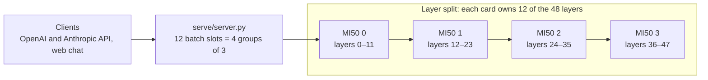
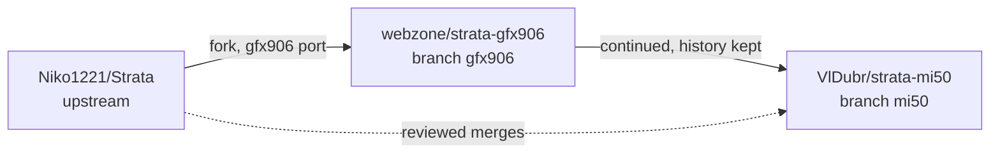

<p align="center">
  <picture>
    <source media="(prefers-color-scheme: dark)" srcset="apps/host/public/brand/strata-lockup-dark.svg">
    
  </picture>
</p>

<h3 align="center">strata-mi50 · Strata for AMD Instinct MI50 / MI60 (gfx906)</h3>

<p align="center">
  Qwen3.8-Flash-Next on four MI50 32 GB cards:<br>
  <b>84 tok/s</b> for one user, <b>172 tok/s</b> in total for ten users at once, up to <b>262,144 tokens</b> of context.<br>
  GLM-5.3-Flash (320B) on the same cards: <b>36 tok/s</b>, <b>131,072 tokens</b> of context, four conversations, pictures.
</p>

<p align="center">
  <a href="#highlights">Highlights</a> · <a href="#performance">Performance</a> ·
  <a href="#quick-start"><b>Quick start</b></a> · <a href="#all-cards-split-tensor-parallel">All-cards split</a> · <a href="#glm-53-flash">GLM-5.3-Flash</a> ·
  <a href="#tuning-for-mi50">Tuning</a> · <a href="#documentation">Docs</a> · <a href="#project-lineage">Lineage</a>
</p>

<p align="center"><b>English</b> · <a href="README.ru.md">Русский</a></p>

<p align="center">
  <a href="https://github.com/Niko1221/Strata/releases/tag/v0.2.12"></a>
  
  
  
  <a href="LICENSE"></a>
</p>

**Source version: Strata v0.2.12 / `146df3c4`** · engine 0.1.58 · llama.cpp / ggml pin `3cf03257` ·
branch [`mi50`](https://github.com/VlDubr/strata-mi50/tree/mi50)

[Strata](https://github.com/Niko1221/Strata) runs large mixture-of-experts models on consumer and workstation GPUs.
Its AMD support targets RDNA cards; the MI50 is an older wave64 (gfx906) card that upstream leaves out. **strata-mi50**
keeps the MI50 working as upstream moves on. It builds upstream's `STRATA_HIP_GFX906` engine for the real gfx906
architecture on ROCm 10, adds MI50-specific decode speed-ups that keep the output bit-for-bit, and ships a tested
4x MI50 deployment that serves twelve requests at once at the model's full context.

> [!NOTE]
> gfx906 support is experimental. Everything below was measured on MI50 32 GB cards. MI60 is the same architecture
> but has no test of its own here.

## Highlights

- **Real gfx906, no tricks.** The engine is compiled for `gfx906` with ROCm 10. No `HSA_OVERRIDE_GFX_VERSION`, no RDNA
  wheels.
- **Faster decode, same output.** Two rounds of MI50 work raised single-request decode from **55.9 to 86.4 tok/s**
  (+55%, mean of three fixed prompts). The greedy output keeps the same bytes.
- **12 requests at once, full context.** On 4x MI50 32 GB: 12 batch slots in 4 pipelined groups, each conversation up
  to 262,144 tokens, all 24,576 experts in VRAM.
- **Batch output equals solo output.** Eight greedy prompts give the same bytes one at a time and all at once.
- **Current with upstream.** Upstream releases are merged through v0.2.12. Every conflict, check and measurement is
  recorded in [docs/GFX906.md](docs/GFX906.md).
- **Ready to deploy.** Dockerfile, launcher and a GPU clock service in [deploy/mi50/](deploy/mi50/).
- **All cards on every layer.** A second engine for Qwen reaches 94-99 tok/s for one request over direct card-to-card stores.
  [The trade-offs](#all-cards-split-tensor-parallel) are below.
- **GLM-5.3-Flash too.** The 320B model runs on 4x MI50 at 36 tok/s decode with its multi-token head, more than three times llama.cpp
  on the same cards, with pictures, tool calls and four conversations at once. [Numbers and steps](#glm-53-flash) are below.

## Performance

**4x MI50 32 GB, Unsloth UD-Q5_K_XL, engine 0.1.58 (Strata v0.2.12), 2026-11-08.** AMD EPYC 7302, 92 GB RAM, Ubuntu 26.04, ROCm 10.0
in the container, GPU DPM level `high`. Qwen3.8-Flash-Next, int8 KV cache, MTP speculative decoding, layer split
12 / 24 / 36. Two profiles of the same model ([Quick start](#3-choose-a-profile)):

| | Solo profile | Parallel profile |
| --- | ---: | ---: |
| Context per conversation | 131,072 | **262,144** |
| Requests decoded together | 1 (others wait) | **12** |
| Decode, 1 request | **84.0 tok/s** | 64.9 tok/s |
| Decode, 4 at once, total | 78.5 tok/s | 119.1 tok/s |
| Decode, 10 at once, total | 78.6 tok/s | **172.3-181.9 tok/s** |
| Decode, 10 at once, each request | 84–105 tok/s, one after another | 17.5–27.4 tok/s, all together |
| First token, 10 at once | 0.2–35.3 s | **0.2–6.1 s** |
| Prefill, real | 1,057–1,060 tok/s (17.7K-token document) | 1,072–1,075 tok/s (17.7K) · 1,309 tok/s (121,216 tokens) |
| Prefill, effective | equal to real: no K/V reuse in these runs | equal to real: no K/V reuse in these runs |
| Decode after the long prompt | — | 54.5 tok/s at 121K · 50.3 tok/s at 253K |

<details>
<summary><b>How it was measured, and what was not</b></summary>

- **Decode rows**: `par.py N` sends N different Russian prompts at once (greedy, streaming, 300 tokens each). *Total* is
  all output tokens divided by the wall time from the first send to the last token. *Each request* is one request's
  tokens after its first, divided by its own streaming time. *First token* includes the time spent in the queue.
- **Real prefill**: new prompt tokens per second of prompt processing, from the engine's own `/metrics` record. The
  server restarted before each run, and no earlier request shared the prompt, so nothing was reused (`cached_tokens`
  0). **Effective prefill** counts reused tokens too; with no reuse it equals the real rate. A warm turn that reuses
  K/V was not measured here.
- **Exactness**: `eqcheck.py` gives 8 / 8 identical outputs one after another and all at once; the four fixed prompts of
  the decode rounds keep their hashes. Against the v0.2.10 image, two interleaved runs of each profile gave the same hashes on all
  four and decode within 0.5%.
- **Rounds**: 10 at once in the parallel profile is two rounds; the other decode points are one round after a warm-up request.
- **The 253K-token prompt** began with the 121K-token one, so the engine reused that part: its prefill rate is not shown.
- **The deployed config** of this server adds the picture readers and has 8 slots instead of 12: 10 at once give 135 tok/s there.
- **Memory**: the parallel profile uses 63 of 91 GB host RAM (the K/V windows are pinned), and all experts stay in VRAM.
- **Not measured**: sampled decoding, more than one round per point, long soak, MI60, other models.
- The v0.2.12 checks: [docs/GFX906.md](docs/GFX906.md#upstream-v0212-synchronization-2026-11-08). The 2026-10-26 round, with raw results
  and scripts: [docs/gfx906-results/20261026-mi50x4-parallel](docs/gfx906-results/20261026-mi50x4-parallel/README.md).
  Solo-profile prefill: the v0.2.6 merge check of the same day in [docs/GFX906.md](docs/GFX906.md#upstream-v026-synchronization-2026-10-26).

</details>

### How 12 requests share four cards



The four slot groups move through the cards like a pipeline, so each card works on a different group at the same
time. Each card keeps its own layers, experts and K/V. With `--kv-resident 32768`, each conversation keeps 32,768 K/V
cells per attention layer in VRAM and the rest in pinned host RAM. That cuts a slot's VRAM cost from 0.50 to 0.29 GiB
per card, so all experts stay in VRAM even with 12 slots at 262,144 tokens.

## Quick start

### Requirements

| | |
| --- | --- |
| **GPUs** | 4x AMD Instinct MI50 32 GB for the profiles below |
| **Host** | Linux with the `amdgpu` kernel driver (`/dev/kfd`, `/dev/dri`) and Docker. The image brings ROCm 10. |
| **CPU / RAM** | x86-64 with AVX2; tested with 92 GB RAM (the parallel profile uses 63 GB) |
| **Disk** | about 170 GB for the model data: the UD-Q5_K_XL download is 158 GB, MTP files and the pack add about 8 GB |

### 1. Build the image

```sh
git clone --branch mi50 https://github.com/VlDubr/strata-mi50.git
cd strata-mi50
docker build -t strata-mi50 -f deploy/mi50/Dockerfile .
```

The image is [`mixa3607/rocm-gfx906`](https://hub.docker.com/r/mixa3607/rocm-gfx906) (ROCm 10 built for gfx906) plus
the Strata engine compiled with `-DSTRATA_HIP_GFX906=ON` for `gfx906`.

### 2. First start: download and prepare the model

```sh
export STRATA_API_KEY="$(python3 -c 'import secrets; print(secrets.token_urlsafe(32))')"
SETUP_ARGS="--family unsloth --model UD-Q5_K_XL --gpus 0,1,2,3 --kv int8 --host 0.0.0.0 --api-key $STRATA_API_KEY" \
  deploy/mi50/run.sh
docker logs -f strata-mi50
```

The first start runs Strata's setup inside the container. Setup downloads the model into `~/strata-data`, prepares it,
writes the config to `~/strata-data/config/strata-unsloth-ud-q5_k_xl.json` and starts the server. Later starts skip
setup and take about three minutes. `run.sh` takes `DATA`, `PORT`, `IMAGE` and `NAME` from the environment.

### 3. Choose a profile

Edit `~/strata-data/config/strata-unsloth-ud-q5_k_xl.json` and restart with `deploy/mi50/run.sh`. Keep the other keys
that setup wrote (`api_key`, `tokenizer`, `log` and so on).

| Profile | Use it for | One request | Ten at once |
| --- | --- | ---: | ---: |
| **Parallel** (the tested deployment) | several users, agents, batch jobs | 65 tok/s | 172 tok/s total |
| **Solo** | one user who wants the fastest single answer | 84 tok/s | 79 tok/s total, queued |

**Parallel profile:**

```json
{
  "args": [
    "--pack", "/data/packs/unsloth-ud-q5_k_xl",
    "--native", "/data/models/unsloth-UD-Q5_K_XL/Qwen3.8-Flash-Next-UD-Q5_K_XL-00001-of-00006.gguf",
    "--expert-profile", "/opt/strata/data/expert-profile.bin",
    "--expert-cache", "auto",
    "--mtp", "/data/mtp/rt",
    "--kv", "int8",
    "--prefill", "3072",
    "--spec", "2",
    "--spec-min-p", "0.8",
    "--mtp-q4", "head",
    "--mtp-draft-vocab", "/opt/strata/data/draft_vocab_cyrillic.bin",
    "--pipeline-windows", "2",
    "--max-context", "262144",
    "--kv-resident", "32768",
    "--trim-stage-weights",
    "--resident-budget-gib", "24"
  ],
  "env": { "STRATA_MMQ_KQ": "1" },
  "gpu": [0, 1, 2, 3],
  "layer_split": "12,24,36",
  "parallel": 12
}
```

<details>
<summary><b>Solo profile</b>: the differences from the parallel profile</summary>

- `--max-context 131072` and `--resident-budget-gib 48`.
- Remove `--kv-resident 32768` and `--trim-stage-weights`.
- `"layer_split": "auto"`, and remove `"parallel"`.

With batch slots on, the engine turns `--pipeline-windows 2` off for a single request, which is why one request is
faster in the solo profile.

</details>

### 4. Pin the GPU clocks (host)

At the default DPM level `auto`, decode on MI50 is about 13% slower. This service sets every card to `high` at boot and
waits for the cards to appear first (`EXPECT` cards, 4 by default).

```sh
sudo install -m 0755 deploy/mi50/host/amdgpu-perf-high.sh /usr/local/sbin/
sudo install -m 0644 deploy/mi50/host/amdgpu-perf-high.service /etc/systemd/system/
sudo systemctl daemon-reload
sudo systemctl enable --now amdgpu-perf-high.service
cat /sys/class/drm/card*/device/power_dpm_force_performance_level   # expect "high" for each card
```

### 5. Connect

| | |
| --- | --- |
| Web chat | `http://<host>:8095/` |
| OpenAI API | `http://<host>:8095/v1` |
| Anthropic API | `http://<host>:8095/v1/messages` |
| Slots in use | `http://<host>:8095/v1/status` (`concurrency.serving`) |

```sh
curl http://<host>:8095/v1/chat/completions \
  -H "Authorization: Bearer $STRATA_API_KEY" -H "Content-Type: application/json" \
  -d '{"model": "qwen3.8-flash-next-unsloth-ud-q5_k_xl",
       "messages": [{"role": "user", "content": "Hello!"}]}'
```

> [!WARNING]
> `--host 0.0.0.0` opens the server on every network interface. Always use a strong API key and a firewall. The config
> file holds the key: never publish it.

<details>
<summary><b>Build without Docker</b></summary>

[deploy/mi50/Dockerfile](deploy/mi50/Dockerfile) is the build recipe. On a host with ROCm for gfx906 in `/opt/rocm`:

```sh
python3 -m venv .venv && .venv/bin/pip install -r requirements.txt
.venv/bin/python -c "import setup; print(setup.get_llama_cpp())"     # the pinned llama.cpp source
cmake -S . -B build -G Ninja -DCMAKE_BUILD_TYPE=Release \
  -DSTRATA_HIP_GFX906=ON -DCMAKE_HIP_ARCHITECTURES=gfx906 \
  -DSTRATA_PORTABLE=ON -DSTRATA_PREFILL_MMQ=OFF -DSTRATA_BUILD_TESTS=OFF \
  -DCMAKE_HIP_COMPILER=/opt/rocm/llvm/bin/clang++ -DCMAKE_PREFIX_PATH=/opt/rocm \
  -DSTRATA_GGML_DIR="$PWD/third_party/llama.cpp"
cmake --build build --target strata
```

Then copy the engine to `engine/` and write `engine/BUILD.json` as the Dockerfile's stamp step does. Setup reuses an
engine stamped this way. Without the stamp, `setup.sh --experimental-gfx906` builds the fork's older wave64 backend
(`STRATA_ENABLE_HIP`), which is deprecated for deployment; the `hip-gfx906` CMake preset builds that backend too and is
kept for its tests. Never set `HSA_OVERRIDE_GFX_VERSION`.

</details>

## All-cards split (tensor parallel)

For Qwen3.8-Flash-Next there is a third way to run the model: `strata-split` gives every card a share of every layer, so all four cards
read weights at once instead of one at a time. It answers one person faster than either profile above. The layer split still wins for
many users and long contexts.

**4x MI50 32 GB, UD-Q5_K_XL, 2026-11-07 and 2026-11-08 (Strata v0.2.12).** The layer split's rows for 4 and 10 requests are from
[Performance](#performance). The rest are the fixed greedy prompts; a range covers the runs of both days.

| | Layer split, solo | Layer split, parallel | All-cards split |
| --- | ---: | ---: | ---: |
| Context per conversation | 131,072 | **262,144** | 131,072 |
| Decode, 1 request | 87 tok/s | 63 tok/s | **94-99 tok/s** |
| Decode, 4 at once, total | 79 tok/s | **119 tok/s** | 88-120 tok/s |
| Decode, 8 at once, total | not measured | not measured | 100-120 tok/s |
| Decode, 10 at once, total | 79 tok/s | **172 tok/s** | at most 8 slots |
| Prefill, 17.7K tokens | **1,060 tok/s** | **1,073 tok/s** | 770-900 tok/s |
| Load | 2-3 min | 2-3 min | 1-2.5 min |

Pictures work. On 17 checked prompts the answers were right as often as the layer split's, and 11 were identical to the character. Three
fresh starts under load gave the same answers and no stall.

```sh
deploy/mi50/run.sh                                 # once: setup downloads the model and writes the config
docker build --build-arg BASE=strata-mi50 -t strata-mi50-split -f deploy/mi50/Dockerfile.split .
docker stop strata-mi50 && deploy/mi50/run-split.sh
docker stop strata-split && deploy/mi50/run.sh     # back to the layer split
```

The first start writes `~/strata-data/config/split.json` from the Qwen config. The API, the port and the model name stay the same.

**Limits.** All conversations share one K/V pool of 225,024 positions, so four full 131,072-token conversations do not fit at once. The
image was tested with the picture-reader Qwen image as `BASE`. `FNX_PRECAP=0` in the config is required: without it, a prompt could wait
about 5 minutes on several slots. [docs/SPLIT_ENGINE.md](docs/SPLIT_ENGINE.md#mi50-gfx906) has the details.

**P2P.** The cards reach each other directly: 12-24 GB/s for stores into a peer's VRAM, with no wrong word. The split engine uses this for
its sums. The layer split gains nothing from it: the hand-off between cards is not what limits it.

## GLM-5.3-Flash

GLM-5.3-Flash (GGUF architecture `glm5-next`, 320B parameters, 288 experts) runs on Strata's DeepSeek engine path
(`strata-dsv41`), built for gfx906. The model does not fit in 128 GB of VRAM: the most-used experts stay on the cards and the
rest run on the CPU from RAM. Its image holds both engines, and only one model runs at a time.

**4x MI50 32 GB, Unsloth UD-Q4_K_XL (199.7 GB), 2026-11-08, Strata v0.2.12.** AMD EPYC 7302, six DDR4-3200 DIMMs, 91 GB RAM, context 131,072,
four conversations, multi-token head with two drafts, picture tower on. Sampled at the model card's settings, API rates.

| | llama.cpp b11786 | Strata |
| --- | ---: | ---: |
| Decode, one answer | 10.8 tok/s | **36 tok/s** |
| Decode, two answers at once, total | not measured | 31 tok/s |
| Decode, four answers at once, total | not measured | 37 tok/s |
| Prefill, 14K tokens | not measured | **183-192 tok/s** |
| Prefill, 28K tokens | not measured | 185-191 tok/s |
| 14K-token prompt with a new end, from a restore point | not measured | 10 s instead of 180 s |
| Load | about 14 min | about 3 min |

Prefill is measured with `--prompt-ring 16`: a prompt's experts that are not in VRAM go to the cards over PCIe
instead of being computed on the CPU. Without it, 14K tokens read at 78 tok/s. [docs/GLM5.md](docs/GLM5.md#prompts) has the details.

What works: the OpenAI and Anthropic APIs, streaming, tool calls, pictures, thinking off (`reasoning_effort: none`,
`enable_thinking: false`, or Anthropic `thinking: disabled`), restore points. Against llama.cpp on the same weights, greedy
tokens match until a near-tie of the top two tokens. With drafts on and off the tokens are the same. Conversations together give
the same logits bit for bit as each alone.

### Requirements

| | |
| --- | --- |
| **GPUs** | 4x AMD Instinct MI50 32 GB |
| **RAM** | tested with 91 GB: the model locks 76 GB and about 12 GB stay free |
| **Disk** | 200 GB for the GGUF files; the pack adds about 6 MB, as it reads the GGUF files in place |
| **Docker** | `--cap-add SYS_ADMIN`, which `run-glm5.sh` passes: `--ram-stripe` reads the frames of its pages |

### Start it

Build the [Qwen image](#1-build-the-image) first, then the GLM image over it. The tested image used the Qwen image with the
picture readers as its base; `BASE` selects another one.

```sh
docker build --build-arg BASE=strata-mi50 -t strata-gfx906:0.2.12-mi50-glm5 -f deploy/mi50/Dockerfile.glm5 .
```

1. Put the GGUF files and `mmproj-BF16.gguf` in one folder, then write the pack with `tools/dsv41/pack_glm5.py`.
2. Add an expert profile. Without one the CPU takes 33% of the expert picks instead of about 21%.
3. Write `~/strata-data/config/glm5.json`. Do not name it `strata-*.json`, or the Qwen image's setup takes it.
4. Run `deploy/mi50/run-glm5.sh`.

[docs/GLM5.md](docs/GLM5.md#deployment) has the exact commands, the config and how to make the profile.

The API is on the same port as Qwen, and the model's name is `glm-5.3-flash`:

```sh
curl http://<host>:8095/v1/chat/completions \
  -H "Authorization: Bearer $STRATA_API_KEY" -H "Content-Type: application/json" \
  -d '{"model": "glm-5.3-flash", "reasoning_effort": "none",
       "messages": [{"role": "user", "content": "Hello!"}]}'
```

### Switch between the models

Both models take every GPU and port 8095, so stop one before you start the other. Stopping GLM frees its 76 GB of RAM.

```sh
docker stop strata-mi50 && deploy/mi50/run-glm5.sh    # Qwen to GLM
docker stop strata-glm5 && deploy/mi50/run.sh         # GLM to Qwen
```

`run-glm5.sh` refuses to start beside the Qwen container. `run.sh` has no such check: with GLM running, Qwen does not start
because the port is taken.

### Limits

- **`--ram-stripe 33.5,65.5` fits one machine.** The numbers are where that machine's RAM regions end, in GiB. Find your own
  bounds with the method in [docs/GLM5.md](docs/GLM5.md#deployment), or leave the switch out. The experts then read from the
  page cache, at about 30 tok/s on this machine.
- **Two answers at once are slower in total than one alone.** The head drafts only while one conversation is answering.
- **Start other large workloads first.** While it loads, the model takes all the RAM it can for a moment. If the RAM is not
  free, it falls back to the page cache.
- **Prefill is slow:** the CPU's share of the experts limits it.
- **No video or audio, no tensor parallel.** A fifth conversation takes the seat used longest ago, and the conversation that
  leaves is read again from its first token.

## Tuning for MI50

Each setting below was measured on the 4x MI50 machine of [Performance](#performance). Details and raw records are in
[docs/GFX906.md](docs/GFX906.md).

| Setting | What it does | Measured effect |
| --- | --- | --- |
| `--mtp-draft-vocab …/draft_vocab_cyrillic.bin` | Draft-head token subset that includes Cyrillic. Setup's default subset has almost none. | +15% decode, +23% on Russian text |
| `--spec 2 --spec-min-p 0.8` | Short verify windows of at most two draft rows | +3 to +5% with the Cyrillic subset |
| `--mtp-q4 head` | Draft head as Q4_0 copies; the verified text is unchanged | +1% |
| `--pipeline-windows 2` | Overlaps verify windows across the layer-split cards | the serial loop is 13% slower |
| `--kv-resident 32768` | 32K K/V cells per layer in VRAM, the rest in pinned RAM | slot cost 0.50 → 0.29 GiB per card |
| `--trim-stage-weights` | Each card allocates only its own layers' dense weights (needs an explicit `layer_split`) | about 3 GiB per card freed |
| `"parallel": 12` with `"layer_split": "12,24,36"` | 12 slots that `--batch-groups auto` runs as 4 groups of 3 | 170.4 tok/s total for 10 requests; 10 slots run as 2 groups of 5 and give 128.1 |
| GPU DPM level `high` | Fixed GPU clocks | `auto` is about 13% slower |
| `HSA_ENABLE_SDMA=0` | Copies by shader instead of the SDMA engines | [why](docs/GFX906.md#why-the-t5810-deployment-runs-hsa_enable_sdma0-2026-10-11) |

**Keep these off on MI50:**

| Switch | Result on MI50 |
| --- | --- |
| The opt-in batch switches of [docs/BATCHING.md](docs/BATCHING.md) (`STRATA_BATCH_GDN_GROUPS`, `STRATA_QSA_SLOTS`, `STRATA_SLOT_COPY_DIRECT` and the rest) | 10 requests fell to 57.5 tok/s total, some to 2–7 tok/s |
| `STRATA_MTP_STAGE0=1` (draft layer on the first card) | −10% |
| `STRATA_SIDE_MIXER`, `STRATA_DF_BRANCH=1` | −2% to −14% |
| `STRATA_HC_Q8=1` | different output text, −1% |
| `STRATA_NORM_ROPE=1` | fails `rope_parity` on gfx906 |
| `--resident-budget-gib 40` instead of 24 (parallel profile) | no gain (160.4 tok/s) |

Upstream's other engine switches and their gfx906 status:
[startup parameters added in v0.1.45](docs/GFX906.md#startup-parameters-added-in-v0145),
[docs/DETAILS.md](docs/DETAILS.md) and `./engine/strata --help`.

## Troubleshooting

- **Decode is about 13% slow.** Check the DPM level (step 4). The cards can appear after an early boot service runs;
  the service in `deploy/mi50/host/` waits for them.
- **A shell in the image.** Pass `--entrypoint sh` to `docker run`. The default entry point runs setup, and without
  the data volume it can start a full model download into an anonymous volume.
- **Logs.** `docker logs strata-mi50` for the server, `~/strata-data/logs/strata-unsloth-ud-q5_k_xl.log` for the engine.
- **GLM decodes at about 30 tok/s, not 36.** Its experts are in the page cache. Check the `--ram-stripe` line in
  `~/strata-data/logs/strata-glm5.log`: it names the GiB in huge pages by region. Free the RAM and restart.
- **gfx906 is rejected.** Setup needs `--backend hip --experimental-gfx906`; the container's entry point passes both.
  Do not spoof another GPU and do not install RDNA wheels.
- **Anything else.** See upstream's [troubleshooting guide](docs/TROUBLESHOOTING.md). For a report, name the fork commit,
  the GPU, the exact model files and what you did not test ([how](docs/COMMUNITY_BENCHMARKS.md)).

## Documentation

| Document | What is in it |
| --- | --- |
| [docs/GFX906.md](docs/GFX906.md) | The fork's log: every upstream merge and its conflicts, every measurement, every decision |
| [docs/GLM5.md](docs/GLM5.md) | GLM-5.3-Flash: design, deployment, tests, where the decode time goes |
| [docs/gfx906-results/](docs/gfx906-results/) | Raw results and scripts behind the numbers |
| [docs/SPLIT_ENGINE.md](docs/SPLIT_ENGINE.md) | The all-cards split engine, MI50 section included |
| [docs/BATCHING.md](docs/BATCHING.md) | Batch slots, slot groups and their switches |
| [docs/MULTI_GPU.md](docs/MULTI_GPU.md) | Layer split across several GPUs |
| [docs/AMD_HIP.md](docs/AMD_HIP.md) | Upstream's AMD scope |
| [docs/DETAILS.md](docs/DETAILS.md) | The engine, the API and all settings |
| [docs/MODELS.md](docs/MODELS.md) | Model choices, sizes and memory needs |
| [AGENTS.md](AGENTS.md) | Development rules of this fork |

Upstream's README describes the desktop app, the prebuilt engines and the RDNA defaults; on MI50 use the steps above
instead.

## Project lineage



- **`mi50`** (default branch): the gfx906 port, the MI50 work and the merged upstream releases.
- **`main`**: a mirror of upstream Strata.
- **Upstream merges** are reviewed merge commits, never a rebase. In a conflict the fork's gfx906 behaviour wins and is
  rebuilt on upstream's new structure; each conflict and the post-merge checks are recorded in
  [docs/GFX906.md](docs/GFX906.md). Merged so far: v0.1.30 (the original port) through v0.2.0-beta+, v0.2.3.1,
  v0.2.6, v0.2.10 and v0.2.12.

### Status and limits

- **Validated:** MI50 32 GB with the upstream `STRATA_HIP_GFX906` text engine, Qwen3.8-Flash-Next, single and
  multi-GPU layer split. GLM-5.3-Flash on 4x MI50 32 GB with `strata-dsv41`.
- **Not validated:** MI60, other models on gfx906, the DeepSeek-V4.1 model itself (`strata-dsv41` now builds for gfx906 and
  its unit tests pass there, but no DeepSeek model was run).
- **Experimental:** the all-cards split on MI50: one day of tests, no long soak.
- **Experimental:** the fork's HIP GPU image encoder (`--vision gpu`), not part of the Docker image; see
  [its limits](docs/GFX906.md#experimental-hip-vision-on-v0139).

## Credits

Upstream Strata is by [Niko1221](https://github.com/Niko1221/Strata). The original gfx906 port is
[webzone/strata-gfx906](https://github.com/webzone/strata-gfx906). [Qwen](https://huggingface.co/Qwen/Qwen3.8-Flash-Next)
made the model; [Unsloth](https://huggingface.co/unsloth/Qwen3.8-Flash-Next-GGUF) and
[ISTA-DASLab](https://huggingface.co/ISTA-DASLab/Qwen3.8-Flash-Next-GSQ-RCO-GGUF) made the GGUF quantizations. Unsloth also
made the GLM-5.3-Flash GGUF. The engine uses [llama.cpp / ggml](https://github.com/ggml-org/llama.cpp); the image builds on
[mixa3607/rocm-gfx906](https://hub.docker.com/r/mixa3607/rocm-gfx906). More acknowledgments:
[upstream credits and licenses](docs/DETAILS.md#credits-and-licenses).

## License

Strata is open source under the [MIT License](LICENSE). Third-party components and model files can have their own
licenses; see their notices and source pages.
