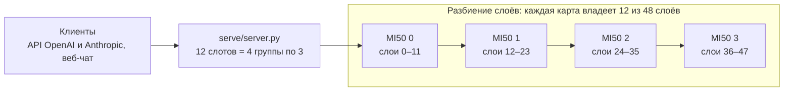
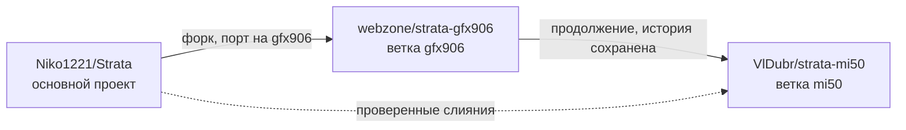

<p align="center">
  <picture>
    <source media="(prefers-color-scheme: dark)" srcset="apps/host/public/brand/strata-lockup-dark.svg">
    
  </picture>
</p>

<h3 align="center">strata-mi50 · Strata для AMD Instinct MI50 / MI60 (gfx906)</h3>

<p align="center">
  Qwen3.8-Flash-Next на четырёх картах MI50 32 ГБ:<br>
  <b>84 ток/с</b> для одного пользователя, <b>172 ток/с</b> суммарно для десяти одновременно, контекст до <b>262 144 токенов</b>.<br>
  GLM-5.3-Flash (320B) на тех же картах: <b>36 ток/с</b>, контекст <b>131 072 токена</b>, четыре диалога, картинки.
</p>

<p align="center">
  <a href="#возможности">Возможности</a> · <a href="#производительность">Производительность</a> ·
  <a href="#быстрый-старт"><b>Быстрый старт</b></a> · <a href="#все-карты-на-каждый-слой-tensor-parallel">Все карты на слой</a> · <a href="#glm-53-flash">GLM-5.3-Flash</a> ·
  <a href="#настройка-под-mi50">Настройка</a> · <a href="#документация">Документация</a> · <a href="#история-проекта">История</a>
</p>

<p align="center"><a href="README.md">English</a> · <b>Русский</b></p>

<p align="center">
  <a href="https://github.com/Niko1221/Strata/releases/tag/v0.2.12"></a>
  
  
  
  <a href="LICENSE"></a>
</p>

**Версия исходников: Strata v0.2.12 / `146df3c4`** · движок 0.1.58 · llama.cpp / ggml `3cf03257` ·
ветка [`mi50`](https://github.com/VlDubr/strata-mi50/tree/mi50)

[Strata](https://github.com/Niko1221/Strata) запускает большие модели с архитектурой mixture-of-experts на потребительских
и рабочих видеокартах. Поддержка AMD в ней рассчитана на карты RDNA, а MI50 — это более старая карта wave64 (gfx906), которую
основной проект не поддерживает. **strata-mi50** сохраняет работу на MI50 по мере развития основного проекта. Форк собирает
движок `STRATA_HIP_GFX906` под настоящую архитектуру gfx906 на ROCm 10, добавляет ускорения декодирования для MI50 с
побитово тем же результатом и включает проверенную конфигурацию для 4x MI50, которая обслуживает двенадцать запросов
одновременно на полном контексте модели.

> [!NOTE]
> Поддержка gfx906 экспериментальная. Всё описанное ниже измерено на картах MI50 32 ГБ. MI60 имеет ту же архитектуру,
> но отдельно здесь не проверялась.

## Возможности

- **Настоящий gfx906, без обходных путей.** Движок компилируется под `gfx906` с ROCm 10. Без `HSA_OVERRIDE_GFX_VERSION` и
  без пакетов для RDNA.
- **Быстрее декодирование, тот же результат.** Две серии доработок для MI50 подняли скорость одного запроса с **55,9 до
  86,4 ток/с** (+55%, среднее по трём фиксированным промптам). Жадный вывод остаётся байт в байт тем же.
- **12 запросов одновременно на полном контексте.** На 4x MI50 32 ГБ: 12 слотов в 4 конвейерных группах, каждый диалог до
  262 144 токенов, все 24 576 экспертов в VRAM.
- **Вывод в батче равен одиночному.** Восемь жадных промптов дают одни и те же байты и по одному, и все вместе.
- **Актуальность с основным проектом.** Релизы влиты вплоть до v0.2.12. Каждый конфликт, проверка и замер записаны в
  [docs/GFX906.md](docs/GFX906.md).
- **Готово к развёртыванию.** Dockerfile, скрипт запуска и служба частот GPU лежат в [deploy/mi50/](deploy/mi50/).
- **Все карты на каждый слой.** Второй движок для Qwen даёт 94–99 ток/с на один запрос за счёт прямой записи между картами.
  [Плюсы и минусы](#все-карты-на-каждый-слой-tensor-parallel) описаны ниже.
- **Также GLM-5.3-Flash.** Модель на 320B работает на 4x MI50 со скоростью 36 ток/с благодаря многотокенной голове: это более
  чем втрое быстрее llama.cpp на тех же картах. Есть картинки, вызовы инструментов и четыре диалога одновременно.
  [Цифры и шаги запуска](#glm-53-flash) приведены ниже.

## Производительность

**4x MI50 32 ГБ, Unsloth UD-Q5_K_XL, движок 0.1.58 (Strata v0.2.12), 2026-11-08.** AMD EPYC 7302, 92 ГБ RAM, Ubuntu 26.04, ROCm 10.0 в
контейнере, уровень DPM видеокарт `high`. Qwen3.8-Flash-Next, кэш KV в int8, спекулятивное декодирование MTP, разбиение слоёв
12 / 24 / 36. Два профиля одной модели ([Быстрый старт](#3-выберите-профиль)):

| | Одиночный профиль | Параллельный профиль |
| --- | ---: | ---: |
| Контекст на диалог | 131 072 | **262 144** |
| Запросов декодируется вместе | 1 (остальные ждут) | **12** |
| Декодирование, 1 запрос | **84,0 ток/с** | 64,9 ток/с |
| Декодирование, 4 одновременно, всего | 78,5 ток/с | 119,1 ток/с |
| Декодирование, 10 одновременно, всего | 78,6 ток/с | **172,3–181,9 ток/с** |
| Декодирование, 10 одновременно, на запрос | 84–105 ток/с, друг за другом | 17,5–27,4 ток/с, все вместе |
| Первый токен, 10 одновременно | 0,2–35,3 с | **0,2–6,1 с** |
| Префилл, реальный | 1 057–1 060 ток/с (документ на 17,7K токенов) | 1 072–1 075 ток/с (17,7K) · 1 309 ток/с (121 216 токенов) |
| Префилл, эффективный | равен реальному: в этих прогонах K/V не переиспользовался | равен реальному: в этих прогонах K/V не переиспользовался |
| Декодирование после длинного промпта | — | 54,5 ток/с на 121K · 50,3 ток/с на 253K |

<details>
<summary><b>Как это измерялось и что не измерялось</b></summary>

- **Строки декодирования**: `par.py N` отправляет N разных русских промптов одновременно (жадно, потоком, по 300 токенов).
  *Всего* — все выходные токены, делённые на время от первой отправки до последнего токена. *На запрос* — токены запроса после
  первого, делённые на время его потока. *Первый токен* включает время в очереди.
- **Реальный префилл**: новые токены промпта в секунду обработки промпта, из записи `/metrics` движка. Сервер перезапускался
  перед каждым прогоном, и ни один предыдущий запрос не имел общего промпта, поэтому переиспользования не было (`cached_tokens`
  равно 0). **Эффективный префилл** учитывает и переиспользованные токены; без переиспользования он равен реальному. Тёплый ход
  с переиспользованием K/V здесь не измерялся.
- **Точность**: `eqcheck.py` даёт 8 из 8 одинаковых ответов по одному и все вместе; четыре фиксированных промпта серий
  декодирования сохраняют свои хэши. Против образа v0.2.10 два чередующихся прогона каждого профиля дали те же хэши на всех
  четырёх и скорость декодирования в пределах 0,5%.
- **Прогоны**: 10 одновременно в параллельном профиле — два прогона; остальные точки — один прогон после прогревочного запроса.
- **Промпт на 253K токенов** начинался с промпта на 121K, и движок переиспользовал эту часть: скорость его префилла не приводится.
- **Конфиг, развёрнутый на этом сервере,** добавляет модули чтения картинок и держит 8 слотов вместо 12: там 10 одновременно дают 135 ток/с.
- **Память**: параллельный профиль использует 63 из 91 ГБ RAM (окна K/V закреплены), все эксперты остаются в VRAM.
- **Не измерялось**: декодирование с семплированием, более одного прогона на точку, длительная нагрузка, MI60, другие модели.
- Проверки v0.2.12: [docs/GFX906.md](docs/GFX906.md#upstream-v0212-synchronization-2026-11-08). Прогон 2026-10-26 с сырыми результатами
  и скриптами: [docs/gfx906-results/20261026-mi50x4-parallel](docs/gfx906-results/20261026-mi50x4-parallel/README.md).
  Префилл одиночного профиля: проверка слияния v0.2.6 того же дня в [docs/GFX906.md](docs/GFX906.md#upstream-v026-synchronization-2026-10-26).

</details>

### Как 12 запросов делят четыре карты



Четыре группы слотов идут по картам как по конвейеру, поэтому каждая карта одновременно работает со своей группой. Каждая карта
хранит свои слои, экспертов и K/V. С `--kv-resident 32768` каждый диалог держит 32 768 ячеек K/V на слой внимания в VRAM, а
остальное в закреплённой RAM. Это снижает стоимость слота в VRAM с 0,50 до 0,29 ГиБ на карту, поэтому все эксперты остаются в
VRAM даже при 12 слотах по 262 144 токена.

## Быстрый старт

### Требования

| | |
| --- | --- |
| **GPU** | 4x AMD Instinct MI50 32 ГБ для профилей ниже |
| **Хост** | Linux с драйвером ядра `amdgpu` (`/dev/kfd`, `/dev/dri`) и Docker. ROCm 10 приносит образ. |
| **CPU / RAM** | x86-64 с AVX2; проверено с 92 ГБ RAM (параллельный профиль использует 63 ГБ) |
| **Диск** | около 170 ГБ для данных модели: загрузка UD-Q5_K_XL занимает 158 ГБ, файлы MTP и пак добавляют около 8 ГБ |

### 1. Соберите образ

```sh
git clone --branch mi50 https://github.com/VlDubr/strata-mi50.git
cd strata-mi50
docker build -t strata-mi50 -f deploy/mi50/Dockerfile .
```

Образ — это [`mixa3607/rocm-gfx906`](https://hub.docker.com/r/mixa3607/rocm-gfx906) (ROCm 10, собранный для gfx906) плюс движок
Strata, скомпилированный с `-DSTRATA_HIP_GFX906=ON` под `gfx906`.

### 2. Первый запуск: загрузка и подготовка модели

```sh
export STRATA_API_KEY="$(python3 -c 'import secrets; print(secrets.token_urlsafe(32))')"
SETUP_ARGS="--family unsloth --model UD-Q5_K_XL --gpus 0,1,2,3 --kv int8 --host 0.0.0.0 --api-key $STRATA_API_KEY" \
  deploy/mi50/run.sh
docker logs -f strata-mi50
```

Первый запуск выполняет настройку Strata внутри контейнера. Настройка загружает модель в `~/strata-data`, готовит её, пишет
конфиг в `~/strata-data/config/strata-unsloth-ud-q5_k_xl.json` и запускает сервер. Следующие запуски пропускают настройку и
занимают около трёх минут. `run.sh` берёт `DATA`, `PORT`, `IMAGE` и `NAME` из окружения.

### 3. Выберите профиль

Отредактируйте `~/strata-data/config/strata-unsloth-ud-q5_k_xl.json` и перезапустите `deploy/mi50/run.sh`. Остальные ключи,
записанные настройкой (`api_key`, `tokenizer`, `log` и другие), оставьте.

| Профиль | Для чего | Один запрос | Десять одновременно |
| --- | --- | ---: | ---: |
| **Параллельный** (проверенное развёртывание) | несколько пользователей, агенты, пакетные задачи | 65 ток/с | 172 ток/с всего |
| **Одиночный** | один пользователь, которому нужен самый быстрый ответ | 84 ток/с | 79 ток/с всего, в очереди |

**Параллельный профиль:**

```json
{
  "args": [
    "--pack", "/data/packs/unsloth-ud-q5_k_xl",
    "--native", "/data/models/unsloth-UD-Q5_K_XL/Qwen3.8-Flash-Next-UD-Q5_K_XL-00001-of-00006.gguf",
    "--expert-profile", "/opt/strata/data/expert-profile.bin",
    "--expert-cache", "auto",
    "--mtp", "/data/mtp/rt",
    "--kv", "int8",
    "--prefill", "3072",
    "--spec", "2",
    "--spec-min-p", "0.8",
    "--mtp-q4", "head",
    "--mtp-draft-vocab", "/opt/strata/data/draft_vocab_cyrillic.bin",
    "--pipeline-windows", "2",
    "--max-context", "262144",
    "--kv-resident", "32768",
    "--trim-stage-weights",
    "--resident-budget-gib", "24"
  ],
  "env": { "STRATA_MMQ_KQ": "1" },
  "gpu": [0, 1, 2, 3],
  "layer_split": "12,24,36",
  "parallel": 12
}
```

<details>
<summary><b>Одиночный профиль</b>: отличия от параллельного</summary>

- `--max-context 131072` и `--resident-budget-gib 48`.
- Уберите `--kv-resident 32768` и `--trim-stage-weights`.
- `"layer_split": "auto"`, и уберите `"parallel"`.

С включёнными слотами движок отключает `--pipeline-windows 2` для одного запроса, поэтому в одиночном профиле один запрос
работает быстрее.

</details>

### 4. Закрепите частоты GPU (на хосте)

На уровне DPM `auto` декодирование на MI50 примерно на 13% медленнее. Эта служба ставит каждой карте `high` при загрузке и
сначала дожидается появления карт (`EXPECT` карт, по умолчанию 4).

```sh
sudo install -m 0755 deploy/mi50/host/amdgpu-perf-high.sh /usr/local/sbin/
sudo install -m 0644 deploy/mi50/host/amdgpu-perf-high.service /etc/systemd/system/
sudo systemctl daemon-reload
sudo systemctl enable --now amdgpu-perf-high.service
cat /sys/class/drm/card*/device/power_dpm_force_performance_level   # для каждой карты должно быть "high"
```

### 5. Подключитесь

| | |
| --- | --- |
| Веб-чат | `http://<host>:8095/` |
| API OpenAI | `http://<host>:8095/v1` |
| API Anthropic | `http://<host>:8095/v1/messages` |
| Занятые слоты | `http://<host>:8095/v1/status` (`concurrency.serving`) |

```sh
curl http://<host>:8095/v1/chat/completions \
  -H "Authorization: Bearer $STRATA_API_KEY" -H "Content-Type: application/json" \
  -d '{"model": "qwen3.8-flash-next-unsloth-ud-q5_k_xl",
       "messages": [{"role": "user", "content": "Привет!"}]}'
```

> [!WARNING]
> `--host 0.0.0.0` открывает сервер на всех сетевых интерфейсах. Всегда используйте надёжный API-ключ и файрвол. Ключ лежит в
> файле конфига: никогда не публикуйте его.

<details>
<summary><b>Сборка без Docker</b></summary>

Рецепт сборки — [deploy/mi50/Dockerfile](deploy/mi50/Dockerfile). На хосте с ROCm для gfx906 в `/opt/rocm`:

```sh
python3 -m venv .venv && .venv/bin/pip install -r requirements.txt
.venv/bin/python -c "import setup; print(setup.get_llama_cpp())"     # закреплённые исходники llama.cpp
cmake -S . -B build -G Ninja -DCMAKE_BUILD_TYPE=Release \
  -DSTRATA_HIP_GFX906=ON -DCMAKE_HIP_ARCHITECTURES=gfx906 \
  -DSTRATA_PORTABLE=ON -DSTRATA_PREFILL_MMQ=OFF -DSTRATA_BUILD_TESTS=OFF \
  -DCMAKE_HIP_COMPILER=/opt/rocm/llvm/bin/clang++ -DCMAKE_PREFIX_PATH=/opt/rocm \
  -DSTRATA_GGML_DIR="$PWD/third_party/llama.cpp"
cmake --build build --target strata
```

Затем скопируйте движок в `engine/` и запишите `engine/BUILD.json`, как это делает шаг штампа в Dockerfile. Настройка
переиспользует движок с таким штампом. Без штампа `setup.sh --experimental-gfx906` собирает старый бэкенд форка wave64
(`STRATA_ENABLE_HIP`), который устарел для развёртывания; пресет CMake `hip-gfx906` тоже собирает этот бэкенд и оставлен ради
его тестов. Никогда не задавайте `HSA_OVERRIDE_GFX_VERSION`.

</details>

## Все карты на каждый слой (tensor parallel)

Для Qwen3.8-Flash-Next есть третий способ запуска: `strata-split` даёт каждой карте долю каждого слоя, поэтому все четыре карты читают веса
одновременно, а не по очереди. Одному пользователю он отвечает быстрее обоих профилей выше. Для многих пользователей и длинного контекста
по-прежнему лучше разбиение слоёв.

**4x MI50 32 ГБ, UD-Q5_K_XL, 2026-11-07 и 2026-11-08 (Strata v0.2.12).** Строки разбиения слоёв для 4 и 10 запросов взяты из раздела
[Производительность](#производительность). Остальное — фиксированные жадные промпты; диапазон охватывает прогоны обоих дней.

| | Разбиение слоёв, одиночный | Разбиение слоёв, параллельный | Все карты на слой |
| --- | ---: | ---: | ---: |
| Контекст на диалог | 131 072 | **262 144** | 131 072 |
| Декодирование, 1 запрос | 87 ток/с | 63 ток/с | **94–99 ток/с** |
| Декодирование, 4 одновременно, всего | 79 ток/с | **119 ток/с** | 88–120 ток/с |
| Декодирование, 8 одновременно, всего | не измерялось | не измерялось | 100–120 ток/с |
| Декодирование, 10 одновременно, всего | 79 ток/с | **172 ток/с** | максимум 8 слотов |
| Префилл, 17,7K токенов | **1 060 ток/с** | **1 073 ток/с** | 770–900 ток/с |
| Загрузка | 2–3 мин | 2–3 мин | 1–2,5 мин |

Картинки работают. На 17 проверочных промптах ответы были верны так же часто, как у разбиения слоёв, а 11 совпали символ в символ. Три свежих
запуска под нагрузкой дали те же ответы и ни одного зависания.

```sh
deploy/mi50/run.sh                                 # один раз: настройка загружает модель и пишет конфиг
docker build --build-arg BASE=strata-mi50 -t strata-mi50-split -f deploy/mi50/Dockerfile.split .
docker stop strata-mi50 && deploy/mi50/run-split.sh
docker stop strata-split && deploy/mi50/run.sh     # обратно на разбиение слоёв
```

Первый запуск пишет `~/strata-data/config/split.json` из конфига Qwen. API, порт и имя модели остаются теми же.

**Ограничения.** Все диалоги делят один пул K/V на 225 024 позиции, поэтому четыре полных диалога по 131 072 токена одновременно не поместятся.
Образ проверялся с образом Qwen с модулями чтения картинок в качестве `BASE`. `FNX_PRECAP=0` в конфиге обязателен: без него промпт на нескольких
слотах мог ждать около 5 минут. Подробности в [docs/SPLIT_ENGINE.md](docs/SPLIT_ENGINE.md#mi50-gfx906).

**P2P.** Карты обращаются друг к другу напрямую: 12–24 ГБ/с при записи в чужую VRAM, без единого неверного слова. Этот движок использует P2P для
своих сумм. Разбиению слоёв P2P ничего не даёт: его ограничивает не передача между картами.

## GLM-5.3-Flash

GLM-5.3-Flash (архитектура GGUF `glm5-next`, 320B параметров, 288 экспертов) работает на движке DeepSeek из Strata
(`strata-dsv41`), собранном под gfx906. Модель не помещается в 128 ГБ VRAM: самые востребованные эксперты остаются на картах,
остальные выполняются на CPU из RAM. Её образ содержит оба движка, но одновременно работает только одна модель.

**4x MI50 32 ГБ, Unsloth UD-Q4_K_XL (199,7 ГБ), 2026-11-08, Strata v0.2.12.** AMD EPYC 7302, шесть модулей DDR4-3200, 91 ГБ RAM, контекст
131 072, четыре диалога, многотокенная голова с двумя черновиками, обработка картинок включена. Семплирование по настройкам
карточки модели, скорости через API.

| | llama.cpp b11786 | Strata |
| --- | ---: | ---: |
| Декодирование, один ответ | 10,8 ток/с | **36 ток/с** |
| Декодирование, два ответа одновременно, всего | не измерялось | 31 ток/с |
| Декодирование, четыре ответа одновременно, всего | не измерялось | 37 ток/с |
| Префилл, 14K токенов | не измерялось | **183–192 ток/с** |
| Префилл, 28K токенов | не измерялось | 185–191 ток/с |
| Промпт на 14K токенов с новым концом, от точки восстановления | не измерялось | 10 с вместо 180 с |
| Загрузка | около 14 мин | около 3 мин |

Префилл измерен с `--prompt-ring 16`: эксперты промпта, которых нет в VRAM, идут на карты по PCIe, а не считаются
на CPU. Без него 14K токенов читаются со скоростью 78 ток/с. Подробности в [docs/GLM5.md](docs/GLM5.md#prompts).

Что работает: API OpenAI и Anthropic, потоковый вывод, вызовы инструментов, картинки, отключение размышлений
(`reasoning_effort: none`, `enable_thinking: false` или `thinking: disabled` в Anthropic), точки восстановления. По сравнению с
llama.cpp на тех же весах жадные токены совпадают до почти равных двух лучших вариантов. С черновиками и без них токены одинаковы.
Диалоги вместе дают побитово те же логиты, что и каждый по отдельности.

### Требования для GLM

| | |
| --- | --- |
| **GPU** | 4x AMD Instinct MI50 32 ГБ |
| **RAM** | проверено с 91 ГБ: модель закрепляет 76 ГБ, свободными остаются около 12 ГБ |
| **Диск** | 200 ГБ для файлов GGUF; пак добавляет около 6 МБ, потому что читает файлы GGUF на месте |
| **Docker** | `--cap-add SYS_ADMIN`, его передаёт `run-glm5.sh`: `--ram-stripe` читает физические кадры своих страниц |

### Запуск

Сначала соберите [образ Qwen](#1-соберите-образ), затем поверх него образ GLM. Проверенный образ использовал как основу образ
Qwen с модулями чтения картинок; другую основу задаёт `BASE`.

```sh
docker build --build-arg BASE=strata-mi50 -t strata-gfx906:0.2.10-mi50-glm5 -f deploy/mi50/Dockerfile.glm5 .
```

1. Положите файлы GGUF и `mmproj-BF16.gguf` в одну папку и запишите пак с помощью `tools/dsv41/pack_glm5.py`.
2. Добавьте профиль экспертов. Без него CPU получает 33% выборов экспертов вместо примерно 21%.
3. Запишите `~/strata-data/config/glm5.json`. Не называйте его `strata-*.json`, иначе его заберёт настройка образа Qwen.
4. Запустите `deploy/mi50/run-glm5.sh`.

Точные команды, конфиг и способ создать профиль описаны в [docs/GLM5.md](docs/GLM5.md#deployment).

API на том же порту, что и у Qwen, имя модели — `glm-5.3-flash`:

```sh
curl http://<host>:8095/v1/chat/completions \
  -H "Authorization: Bearer $STRATA_API_KEY" -H "Content-Type: application/json" \
  -d '{"model": "glm-5.3-flash", "reasoning_effort": "none",
       "messages": [{"role": "user", "content": "Привет!"}]}'
```

### Переключение между моделями

Обе модели занимают все GPU и порт 8095, поэтому остановите одну перед запуском другой. Остановка GLM освобождает 76 ГБ RAM.

```sh
docker stop strata-mi50 && deploy/mi50/run-glm5.sh    # с Qwen на GLM
docker stop strata-glm5 && deploy/mi50/run.sh         # с GLM на Qwen
```

`run-glm5.sh` откажется стартовать рядом с контейнером Qwen. В `run.sh` такой проверки нет: при работающем GLM Qwen не запустится,
потому что порт занят.

### Ограничения

- **`--ram-stripe 33.5,65.5` подходит одной машине.** Числа — это границы регионов RAM этой машины в ГиБ. Определите свои границы
  способом из [docs/GLM5.md](docs/GLM5.md#deployment) или уберите ключ. Тогда эксперты читаются из кэша страниц, на этой машине это
  около 30 ток/с.
- **Два ответа одновременно суммарно медленнее одного.** Голова пишет черновики, только пока отвечает один диалог.
- **Другие большие нагрузки запускайте первыми.** При загрузке модель на короткое время занимает всю доступную RAM. Если RAM не
  свободна, модель откатывается на кэш страниц.
- **Префилл медленный:** его ограничивает доля экспертов на CPU.
- **Нет видео, аудио и тензорного параллелизма.** Пятый диалог занимает место, которое дольше всего не использовалось, а вытесненный
  диалог перечитывается с первого токена.

## Настройка под MI50

Каждая настройка ниже измерена на машине 4x MI50 из раздела [Производительность](#производительность). Подробности и сырые записи
есть в [docs/GFX906.md](docs/GFX906.md).

| Настройка | Что делает | Измеренный эффект |
| --- | --- | --- |
| `--mtp-draft-vocab …/draft_vocab_cyrillic.bin` | Набор токенов черновой головы с кириллицей. В наборе настройки по умолчанию кириллицы почти нет. | +15% к декодированию, +23% на русском тексте |
| `--spec 2 --spec-min-p 0.8` | Короткие окна проверки максимум из двух черновых строк | от +3 до +5% с кириллическим набором |
| `--mtp-q4 head` | Черновая голова как копии Q4_0; проверенный текст не меняется | +1% |
| `--pipeline-windows 2` | Перекрывает окна проверки между картами разбиения слоёв | последовательный цикл на 13% медленнее |
| `--kv-resident 32768` | 32K ячеек K/V на слой в VRAM, остальное в закреплённой RAM | стоимость слота 0,50 → 0,29 ГиБ на карту |
| `--trim-stage-weights` | Каждая карта выделяет только плотные веса своих слоёв (нужен явный `layer_split`) | освобождается около 3 ГиБ на карту |
| `"parallel": 12` с `"layer_split": "12,24,36"` | 12 слотов, которые `--batch-groups auto` запускает как 4 группы по 3 | 170,4 ток/с всего на 10 запросов; 10 слотов идут как 2 группы по 5 и дают 128,1 |
| Уровень DPM `high` | Фиксированные частоты GPU | `auto` примерно на 13% медленнее |
| `HSA_ENABLE_SDMA=0` | Копирование шейдерами вместо движков SDMA | [почему](docs/GFX906.md#why-the-t5810-deployment-runs-hsa_enable_sdma0-2026-10-11) |

**На MI50 держите это выключенным:**

| Ключ | Результат на MI50 |
| --- | --- |
| Опциональные ключи батчинга из [docs/BATCHING.md](docs/BATCHING.md) (`STRATA_BATCH_GDN_GROUPS`, `STRATA_QSA_SLOTS`, `STRATA_SLOT_COPY_DIRECT` и другие) | 10 запросов упали до 57,5 ток/с всего, некоторые до 2–7 ток/с |
| `STRATA_MTP_STAGE0=1` (черновой слой на первой карте) | −10% |
| `STRATA_SIDE_MIXER`, `STRATA_DF_BRANCH=1` | от −2% до −14% |
| `STRATA_HC_Q8=1` | другой текст ответа, −1% |
| `STRATA_NORM_ROPE=1` | не проходит `rope_parity` на gfx906 |
| `--resident-budget-gib 40` вместо 24 (параллельный профиль) | выигрыша нет (160,4 ток/с) |

Другие ключи движка из основного проекта и их статус на gfx906:
[параметры запуска, добавленные в v0.1.45](docs/GFX906.md#startup-parameters-added-in-v0145),
[docs/DETAILS.md](docs/DETAILS.md) и `./engine/strata --help`.

## Решение проблем

- **Декодирование примерно на 13% медленнее.** Проверьте уровень DPM (шаг 4). Карты могут появиться позже ранней службы загрузки;
  служба из `deploy/mi50/host/` их дожидается.
- **Оболочка в образе.** Передайте `--entrypoint sh` в `docker run`. Точка входа по умолчанию запускает настройку, и без тома с
  данными она может начать полную загрузку модели в анонимный том.
- **Логи.** `docker logs strata-mi50` для сервера, `~/strata-data/logs/strata-unsloth-ud-q5_k_xl.log` для движка.
- **GLM декодирует примерно на 30 ток/с, а не 36.** Его эксперты в кэше страниц. Проверьте строку `--ram-stripe` в
  `~/strata-data/logs/strata-glm5.log`: там указаны ГиБ в огромных страницах по регионам. Освободите RAM и перезапустите.
- **gfx906 отклоняется.** Настройке нужны `--backend hip --experimental-gfx906`; точка входа контейнера передаёт оба ключа.
  Не подделывайте другой GPU и не ставьте пакеты для RDNA.
- **Всё остальное.** Смотрите [руководство по решению проблем](docs/TROUBLESHOOTING.md) основного проекта. В отчёте укажите коммит
  форка, GPU, точные файлы модели и что вы не проверяли ([как](docs/COMMUNITY_BENCHMARKS.md)).

## Документация

Документы написаны на английском.

| Документ | Что в нём |
| --- | --- |
| [docs/GFX906.md](docs/GFX906.md) | Журнал форка: каждое слияние с основным проектом и его конфликты, каждый замер, каждое решение |
| [docs/GLM5.md](docs/GLM5.md) | GLM-5.3-Flash: устройство, развёртывание, тесты, куда уходит время декодирования |
| [docs/gfx906-results/](docs/gfx906-results/) | Сырые результаты и скрипты за цифрами |
| [docs/SPLIT_ENGINE.md](docs/SPLIT_ENGINE.md) | Движок «все карты на слой», включая раздел про MI50 |
| [docs/BATCHING.md](docs/BATCHING.md) | Слоты, группы слотов и их ключи |
| [docs/MULTI_GPU.md](docs/MULTI_GPU.md) | Разбиение слоёв на несколько GPU |
| [docs/AMD_HIP.md](docs/AMD_HIP.md) | Что основной проект поддерживает на AMD |
| [docs/DETAILS.md](docs/DETAILS.md) | Движок, API и все настройки |
| [docs/MODELS.md](docs/MODELS.md) | Выбор модели, размеры и требования к памяти |
| [AGENTS.md](AGENTS.md) | Правила разработки этого форка |

README основного проекта описывает настольное приложение, готовые движки и настройки для RDNA; на MI50 вместо этого используйте шаги
выше.

## История проекта



- **`mi50`** (ветка по умолчанию): порт на gfx906, работа для MI50 и влитые релизы основного проекта.
- **`main`**: зеркало основного проекта Strata.
- **Слияния с основным проектом** — это проверенные merge-коммиты, никогда не rebase. При конфликте побеждает поведение форка для
  gfx906, которое пересобирается на новой структуре основного проекта; каждый конфликт и проверки после слияния записаны в
  [docs/GFX906.md](docs/GFX906.md). Влиты: от v0.1.30 (исходный порт) до v0.2.0-beta+, v0.2.3.1, v0.2.6, v0.2.10 и v0.2.12.

### Статус и ограничения

- **Проверено:** MI50 32 ГБ с текстовым движком `STRATA_HIP_GFX906`, Qwen3.8-Flash-Next, одна карта и разбиение слоёв на несколько.
  GLM-5.3-Flash на 4x MI50 32 ГБ со `strata-dsv41`.
- **Не проверено:** MI60, другие модели на gfx906, сама модель DeepSeek-V4.1 (`strata-dsv41` теперь собирается под gfx906 и его
  юнит-тесты там проходят, но модель DeepSeek не запускалась).
- **Экспериментально:** режим «все карты на слой» на MI50: один день тестов, длительной нагрузки не было.
- **Экспериментально:** кодировщик картинок HIP из форка (`--vision gpu`), не входит в образ Docker; смотрите
  [его ограничения](docs/GFX906.md#experimental-hip-vision-on-v0139).

## Благодарности

Основной проект Strata создан [Niko1221](https://github.com/Niko1221/Strata). Исходный порт на gfx906 —
[webzone/strata-gfx906](https://github.com/webzone/strata-gfx906). Модель создала [Qwen](https://huggingface.co/Qwen/Qwen3.8-Flash-Next);
квантизации GGUF сделали [Unsloth](https://huggingface.co/unsloth/Qwen3.8-Flash-Next-GGUF) и
[ISTA-DASLab](https://huggingface.co/ISTA-DASLab/Qwen3.8-Flash-Next-GSQ-RCO-GGUF). GGUF модели GLM-5.3-Flash тоже сделали Unsloth.
Движок использует [llama.cpp / ggml](https://github.com/ggml-org/llama.cpp); образ основан на
[mixa3607/rocm-gfx906](https://hub.docker.com/r/mixa3607/rocm-gfx906). Другие благодарности:
[авторы и лицензии основного проекта](docs/DETAILS.md#credits-and-licenses).

## Лицензия

Strata — открытое ПО под [лицензией MIT](LICENSE). Сторонние компоненты и файлы моделей могут иметь собственные лицензии; смотрите их
уведомления и страницы исходников.
